<div align="center">

<!-- Live Boot-Up & Laser-Scanned ASCII Avatar Telemetry -->


<p>
  <a href="https://github.com/Aman-lab1"></a>
  <a href="https://www.linkedin.com/in/aman-rajpura-a1a1433bb/"></a>
  <a href="mailto:amanrajpura789@gmail.com"></a>
</p>

</div>

---

### Engineering Philosophy

I build at the intersection of **Electrical & Electronics Engineering**, **embedded hardware**, and **edge AI systems**—designing machines and local-first software where physical sensing, deterministic control, and clean interfaces work as a single system.

<table>
  <tr>
    <td width="33%" valign="top">
      <strong>01 // Physical &amp; Embedded</strong><br/>
      <sub>ESP32, Arduino, motor control, optical OOK transceivers, sensor fusion, KiCad &amp; Fusion 360.</sub>
    </td>
    <td width="33%" valign="top">
      <strong>02 // Deterministic AI</strong><br/>
      <sub>Hybrid local/cloud inference (Ollama + Groq) with verified tool-execution pipelines.</sub>
    </td>
    <td width="33%" valign="top">
      <strong>03 // Local-First Software</strong><br/>
      <sub>Offline-capable PWAs with IndexedDB persistence, zero-server latency, and clean UX.</sub>
    </td>
  </tr>
</table>

---

### Active & Recent Builds

<!-- Auto-ranked by recent commits & sustained development activity -->
<div align="center">
  
</div>

---

### Featured Architecture: **Rexy** (`R&D`)

```text
[ Voice / Text ] ──▶ [ Intent Router ] ──▶ [ THINK → VERIFY → EXECUTE ] ──▶ [ Hardware / OS Tools ]
                                                       ▲
                                            [ Persistent Context ]